# Bitly (URL Shortener) System Design

A full walkthrough of designing a URL shortener like Bitly: requirements, API, data model, high-level design, deep dives, scaling, and the final architecture.

> A URL shortener looks simple, but it is one of the best problems for learning how to design a **read-heavy system**. Almost every decision in this design comes from one fact: people click short links far more often than they create them.

---

## Table of Contents

1. [What Are We Building?](#1-what-are-we-building)
2. [Functional Requirements](#2-functional-requirements)
3. [Non-Functional Requirements](#3-non-functional-requirements)
4. [Back-of-the-Envelope Estimation](#4-back-of-the-envelope-estimation)
5. [Core Entities](#5-core-entities)
6. [API Design](#6-api-design)
7. [Data Model](#7-data-model)
8. [High-Level Design](#8-high-level-design)
9. [Deep Dive 1: Generating Unique Short Codes](#9-deep-dive-1-generating-unique-short-codes)
10. [Deep Dive 2: Making Redirects Fast](#10-deep-dive-2-making-redirects-fast)
11. [Deep Dive 3: Scaling to 1B URLs and 100M DAU](#11-deep-dive-3-scaling-to-1b-urls-and-100m-dau)
12. [Final Architecture](#12-final-architecture)
13. [Failure Scenarios](#13-failure-scenarios)
14. [Security Considerations](#14-security-considerations)
15. [What Interviewers Expect at Each Level](#15-what-interviewers-expect-at-each-level)
16. [Interview Walkthrough Script](#16-interview-walkthrough-script)
17. [Cheat Sheet](#17-cheat-sheet)

---

## 1. What Are We Building?

A URL shortener takes a long URL like:

```
https://www.example.com/articles/2026/system-design/how-to-build-a-url-shortener?ref=newsletter
```

and turns it into a short one like:

```
https://short.ly/abc123
```

When someone opens the short link, the service looks up the original URL and **redirects** the browser there.

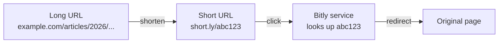

The short code (`abc123`) is the heart of the system. Most of the design is about two questions:

1. **How do we create short codes** that are unique and short?
2. **How do we look them up fast** when millions of people click?

---

## 2. Functional Requirements

Functional requirements are **what the system does**. In an interview, focus on the top 3–4 features and leave the rest "below the line."

### Core requirements

| # | Requirement |
|---|---|
| 1 | Users can submit a **long URL** and receive a **short URL** |
| 2 | *(Optional)* Users can choose a **custom alias**, e.g. `short.ly/my-portfolio` |
| 3 | *(Optional)* Users can set an **expiration date** for a short URL |
| 4 | Users who open a short URL are **redirected** to the original URL |

### Out of scope (below the line)

- User accounts, login, and authentication
- Click analytics (click counts, location, device)
- Spam and malicious URL detection

These add real value in a product, but they are not core to *shortening* and *redirecting*. In an interview, mention them and confirm with the interviewer before leaving them out.

---

## 3. Non-Functional Requirements

Non-functional requirements are **how well the system works**.

| Requirement | Target | Why it matters |
|---|---|---|
| **Uniqueness** | Each short code maps to exactly one long URL | Two URLs sharing a code would send users to the wrong page |
| **Low latency** | Redirect in **< 100 ms** | A redirect is an extra hop before the real page; it must feel instant |
| **High availability** | **99.99%** uptime | If we're down, every link ever shared is broken |
| **Scale** | **1B** short URLs, **100M** daily active users | Defines storage and traffic numbers |

### Consistency or availability?

Using the CAP theorem lens: **availability > consistency.**

If a newly created link takes a second to become visible everywhere, nobody is harmed. But if the service is down, every link on the internet that points to us is broken. So we prefer to stay up, and accept eventual consistency for reads.

> **Exception:** creating a short code must still be **unique**. We get that guarantee from the code generation strategy and a database `UNIQUE` constraint, not from strong consistency on every read.

### The most important observation: reads dominate


For every **1** short URL created, there might be **~1,000** clicks. This **1000:1 read-to-write ratio** drives the whole design: caching, CDN, database choice, and splitting read and write services.

---

## 4. Back-of-the-Envelope Estimation

### Traffic

| Metric | Calculation | Result |
|---|---|---|
| Redirects per day | 100M DAU × 5 clicks | **500M / day** |
| Average redirects per second | 500M ÷ 86,400 | **~5,800 / sec** |
| Peak redirects per second | ~100× average for spikes (viral links, peak hours) | **~600k / sec** |
| New URLs per day | assumption | **~100k / day** |
| Writes per second | 100k ÷ 86,400 | **~1–2 / sec** |

Reads are huge. Writes are tiny.

### Storage

| Field | Size |
|---|---|
| Short code | ~8 bytes |
| Long URL | ~100 bytes |
| Created at | ~8 bytes |
| Custom alias (optional) | ~100 bytes |
| Expiration date | ~8 bytes |
| **Total per row** | **~200 bytes** |
| Rounded up for extra metadata (creator, etc.) | **~500 bytes** |

**1B rows × 500 bytes = ~500 GB.**

That fits comfortably on **one** modern database instance (Postgres handles tens of terabytes). So we **don't need to shard** for storage. This is an important conclusion: don't shard until the math says so.

---

## 5. Core Entities

Keep this simple in an interview. Fields come later.

| Entity | Meaning |
|---|---|
| **Original URL** | The long URL the user wants to shorten |
| **Short URL** | The short code that maps to the original URL |
| **User** | Who created the short URL (needed later for ownership and analytics) |

---

## 6. API Design

We use **REST**. Each core requirement maps to one endpoint.

### 6.1 Create a short URL

We use `POST` because we are **creating** a new mapping.

```http
POST /urls
Content-Type: application/json

{
  "long_url": "https://www.example.com/some/very/long/url",
  "custom_alias": "my-alias",          // optional
  "expiration_date": "2026-12-31"      // optional
}
```

**Response**

```http
201 Created

{
  "short_url": "https://short.ly/abc123"
}
```

| Status | When |
|---|---|
| `201 Created` | Short URL created |
| `400 Bad Request` | Invalid long URL or alias format |
| `409 Conflict` | Custom alias already taken |

### 6.2 Redirect to the original URL

We use `GET` because we are **reading** an existing mapping.

```http
GET /{short_code}
```

**Response**

```http
302 Found
Location: https://www.example.com/some/very/long/url
```

| Status | When |
|---|---|
| `302 Found` | Code exists and is valid; browser follows `Location` |
| `404 Not Found` | Code never existed |
| `410 Gone` | Code existed but has expired |

> Why `302` and not `301`? See [Section 8.3](#83-301-vs-302-redirects).

---

## 7. Data Model

A single main table is enough.

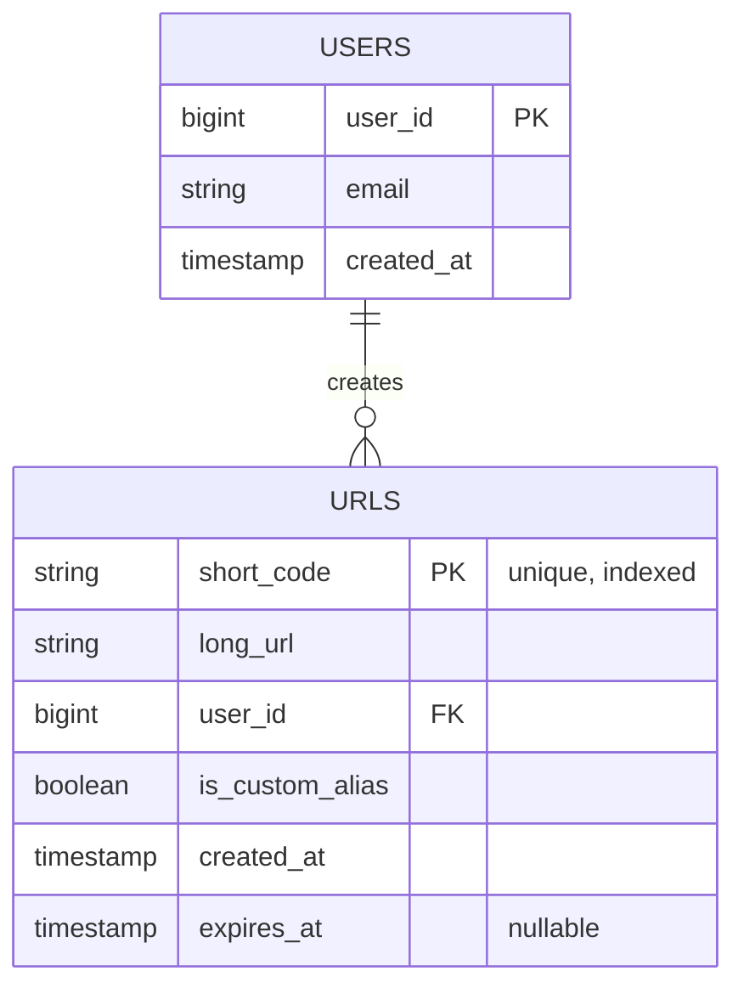

```sql
CREATE TABLE urls (
    short_code      VARCHAR(16) PRIMARY KEY,   -- B-tree index + uniqueness for free
    long_url        TEXT        NOT NULL,
    user_id         BIGINT,
    is_custom_alias BOOLEAN     NOT NULL DEFAULT FALSE,
    created_at      TIMESTAMP   NOT NULL DEFAULT NOW(),
    expires_at      TIMESTAMP
);
```

Key decisions:

- **`short_code` is the primary key.** This gives us a B-tree index (fast lookups) **and** a uniqueness guarantee (the database rejects duplicates). The redirect query is always `WHERE short_code = ?`, so this is exactly the index we need.
- **`expires_at` is nullable.** Most links never expire.
- **No index on `long_url`** unless we want deduplication (see below).

### Should the same long URL always get the same short code?

| Option | Pros | Cons |
|---|---|---|
| **Deduplicate** (same URL → same code) | Saves storage | Needs an index on `long_url`; users can't have separate expiry, alias, or analytics; reveals that someone already shortened that URL |
| **Allow duplicates** (each request gets its own code) | Each link has its own settings; simpler writes | Slightly more storage |

**Most real shorteners allow duplicates.** Storage is cheap (500 GB total), and independent links are more useful.

---

## 8. High-Level Design

Start simple: one server, one database. Then improve it through deep dives.

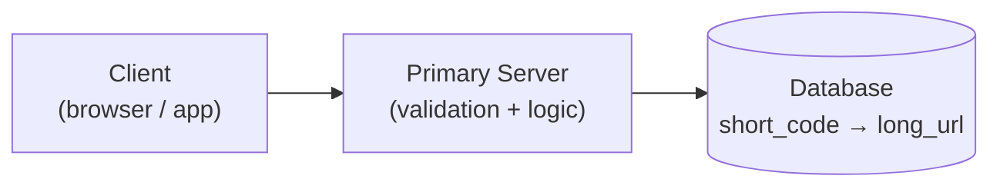

### 8.1 Flow 1: Creating a short URL

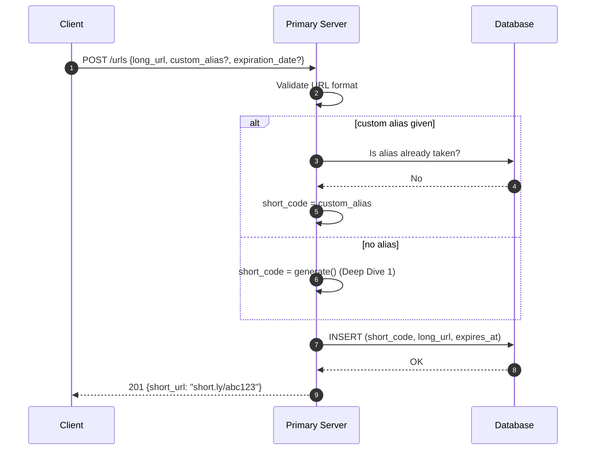

Steps:

1. **Validate** the long URL (correct format, allowed scheme like `http`/`https`).
2. **Pick the short code:**
   - If a custom alias was provided, check it isn't taken.
   - Otherwise, generate one. (How? That's [Deep Dive 1](#9-deep-dive-1-generating-unique-short-codes).)
3. **Store** the mapping in the database.
4. **Return** the short URL.

> **Avoiding alias collisions with generated codes:** a user might pick an alias like `abc123` that the generator would later produce. Fix it by giving generated codes a reserved prefix (e.g. they always start with a digit `0`) and requiring custom aliases to start with a letter, or by keeping the two in separate namespaces.

### 8.2 Flow 2: Redirecting

The short URL lives on a domain **we own** (`short.ly`), so every click reaches our server.

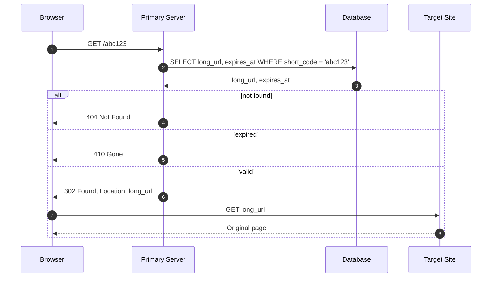

The browser follows the redirect automatically. The user just sees the final page.

**Cleaning up expired links:** a background job can periodically delete expired rows (or simply leave them, since the check happens on read). If we cache mappings, the **cache TTL must be no longer than the link's remaining lifetime**, so an expired link isn't served from cache.

### 8.3 301 vs 302 Redirects

This is a classic interview discussion.

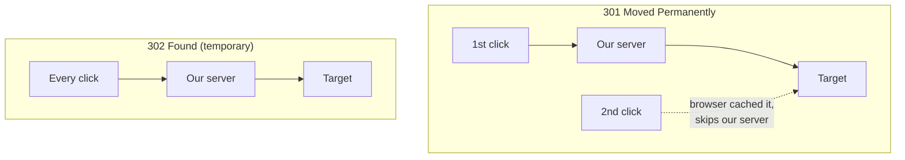

| | **301 Permanent** | **302 Temporary** |
|---|---|---|
| Browser caches the redirect? | Yes, future clicks may skip our server | No, every click comes to us |
| Can we change or expire the link later? | Not for users who already cached it | Yes, anytime |
| Click analytics possible? | No (we don't see repeat clicks) | Yes |
| Load on our servers | Lower | Higher |

**Choice: `302`.** A URL shortener is an **indirection service**. Its whole value is that *we* control where the link goes. A cached `301` permanently gives that control away:

- A typo in the destination can't be fixed for users who already clicked.
- Expiration can't be enforced.
- If analytics is added later, we've already lost data for every cached `301`.

> Some people argue for `301` when analytics is out of scope, because it reduces load. It's a fair trade-off to mention, but the loss of control is usually the stronger argument.

---

## 9. Deep Dive 1: Generating Unique Short Codes

We need codes that are:

1. **Unique**: no two URLs share a code
2. **Short**: it's a URL shortener after all
3. **Fast to generate**: no expensive work per request

Let's compare three approaches.

### 9.1 ❌ Bad: Use a prefix of the long URL

Take the first 8 characters of the URL as the code.

```
www.linkedin.com/in/alice  →  short.ly/www.link
www.linkedin.com/in/bob    →  short.ly/www.link   ← collision!
```

Every URL sharing a prefix collides. Fails requirement #1 immediately.

### 9.2 ✅ Good: Hash the URL + Base62 encode

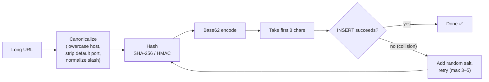

```python
canonical = canonicalize(long_url)
digest    = sha256(canonical + optional_salt)
code      = base62_encode(digest)[:8]
# INSERT ... if UNIQUE violation → retry with a new salt
```

**Why Base62?** It uses `0-9`, `a-z`, `A-Z` — 62 URL-safe characters. Base64 adds `+` and `/`, but `/` is a path separator and `+` can mean a space in URLs, so we drop them.

**How many codes do 8 characters give?**

| Length | Possible codes |
|---|---|
| 6 | 62⁶ ≈ **56.8 billion** |
| 7 | 62⁷ ≈ **3.5 trillion** |
| 8 | 62⁸ ≈ **218 trillion** |

**Pros**

- No coordination between servers; any server can generate a code.
- Codes look random, so they're hard to guess.

**Cons**

- **Collisions are possible.** With `n` codes already used out of `|S|` possible, the chance the next one collides is `n / |S|`. It grows as the table fills.
- The same URL always hashes to the same code. That's fine for deduplication, but if you want separate codes per user, add a **salt** (or use HMAC with a secret key).
- Each collision needs a retry, which adds a database round trip.

**Handling collisions:** rely on the `UNIQUE` constraint (primary key). If the insert fails, add a random salt and try again, up to 3–5 times.

### 9.3 ✅ Great: Global counter + Base62 encode

Keep a counter. Every new URL gets the next number. Encode the number in Base62.

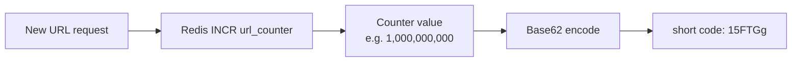

**Base62 encoding, step by step** (alphabet `0-9 a-z A-Z`):

```
125 ÷ 62 = 2 remainder 1   →  digits [2, 1]  →  "21"
```

| Counter value | Base62 code | Length |
|---|---|---|
| 125 | `21` | 2 |
| 1,000 | `g8` | 2 |
| 1,000,000 | `4c92` | 4 |
| 1,000,000,000 | `15FTGg` | **6** |

Even after **1 billion URLs**, codes are only **6 characters**. We only need 7 characters after ~56.8 billion URLs.

**Why Redis for the counter?** Redis processes commands on a single thread, and `INCR` is atomic. Two simultaneous requests always get different numbers (e.g. 1000 and 1001). No race conditions.

**Pros**

- **Zero collisions**, guaranteed. No retries, no extra lookups.
- Codes are as short as mathematically possible.
- Cheap to compute.

**Cons**

- **Needs a single source of truth** across all servers (solved in [Deep Dive 3](#113-the-counter-problem)).
- **Codes are predictable.** Someone could walk through `abc120`, `abc121`, `abc122`... and discover links. Fix: apply a reversible transformation (e.g. XOR with a secret key, or a small block cipher) before encoding. Or accept it, since short links are usually meant to be public.

### 9.4 Comparison

| | URL prefix | Hash + Base62 | Counter + Base62 |
|---|---|---|---|
| Unique? | ❌ | Mostly (retry on collision) | ✅ Always |
| Short? | ✅ | ✅ (8 chars) | ✅✅ (6 chars at 1B) |
| Coordination needed? | No | No | Yes (shared counter) |
| Guessable? | Yes | No | Yes (unless obfuscated) |
| Verdict | ❌ | ✅ Good | ✅ **Best for interviews** |

**Other options worth knowing:**

- **Snowflake IDs** (timestamp + machine ID + sequence): each server generates unique IDs without a shared counter. Trade-off: the ID is a 64-bit number, so codes become ~11 characters instead of ~6.
- **Pre-generated key pool:** generate random unique codes offline, store them in a "keys" table, and hand them out. No collisions at request time, but more moving parts.

---

## 10. Deep Dive 2: Making Redirects Fast

### 10.1 The problem

Recall: **~600k redirects/sec at peak.** Without any index, finding `abc123` among 1 billion rows means a **full table scan**. That's far too slow.

### 10.2 ✅ Good: Index the short code

Making `short_code` the **primary key** gives us a B-tree index automatically. Lookups become **O(log n)**, a few disk pages.

But even indexed lookups hit limits at our scale:

| Storage | Access time | Throughput |
|---|---|---|
| Memory (RAM) | ~100 nanoseconds | Millions of ops/sec |
| SSD | ~0.1 milliseconds | ~100k IOPS |
| HDD | ~10 milliseconds | ~100–200 IOPS |

A single database at ~600k reads/sec would struggle, and heavy reads would slow down writes too.

### 10.3 ✅ Great: Add an in-memory cache (Redis)

Short links are a perfect caching workload:

- **Read-heavy:** 1000:1
- **Almost never change:** a mapping is written once
- **Skewed popularity:** a small number of viral links get most clicks

We use **cache-aside**:

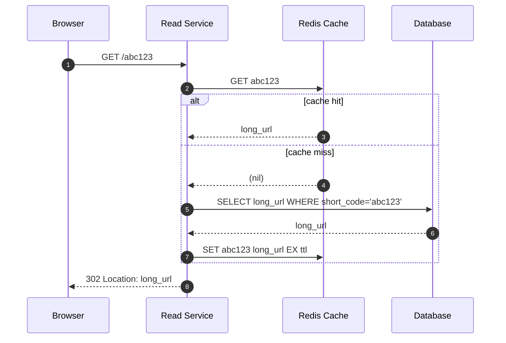

| Decision | Choice | Reason |
|---|---|---|
| Pattern | **Cache-aside** | Simple; only caches what's actually clicked |
| Eviction | **LRU** | Recently clicked links are likely to be clicked again |
| TTL | ≤ link's remaining lifetime | Expired links must never be served from cache |
| Invalidation | Delete key on update/delete | Rare, since mappings almost never change |

**Challenges**

- **Cold start:** an empty cache sends everything to the database until it warms up.
- **Memory limits:** need an eviction policy and sizing (though 500 GB of mappings could even fit in a large cache).
- **Viral link expiring at once:** many requests miss together (cache stampede). Use request coalescing so only one request rebuilds the key.

### 10.4 ✅ Great: CDN + edge computing

Go one step further and handle redirects **close to the user**, before they reach our servers.

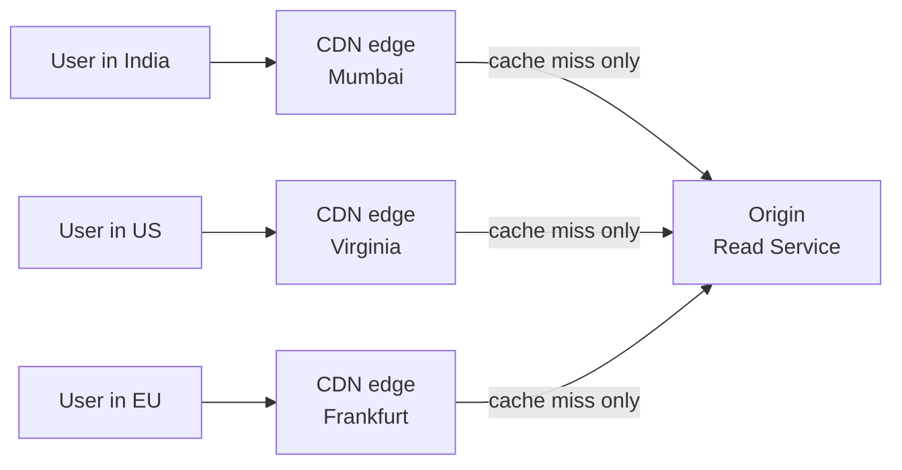

- Serve `short.ly` through a CDN with edge locations worldwide.
- Run the redirect logic at the edge (Cloudflare Workers, AWS Lambda@Edge).
- Popular codes are redirected **at the edge** and never touch our origin.

**Challenges**

- Invalidating a changed or expired link across hundreds of edge nodes.
- Cost at high traffic.
- Edge runtimes have limits on execution time, memory, and libraries.
- Harder debugging and monitoring.

### 10.5 The read path in layers

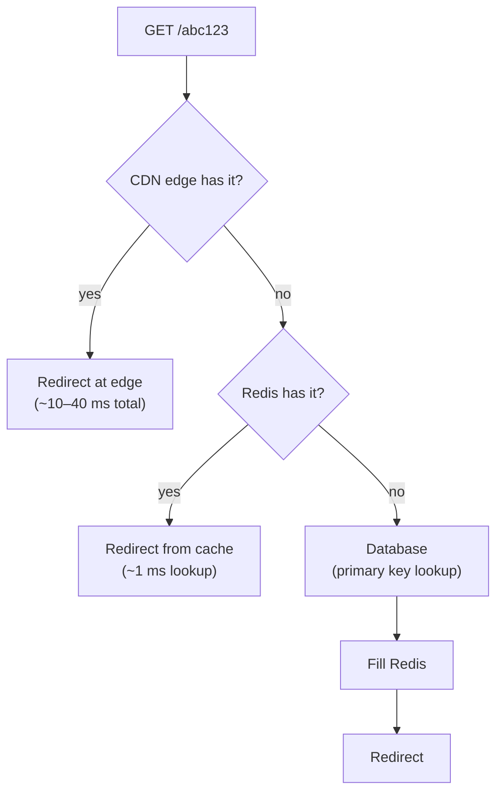

Each layer absorbs most of the traffic, so only a tiny fraction reaches the database.

---

## 11. Deep Dive 3: Scaling to 1B URLs and 100M DAU

### 11.1 Database: do we need to shard?

- **Storage:** ~500 GB. Fits on one instance. ✅
- **Writes:** ~1–2/sec. Trivial. ✅
- **Reads:** mostly absorbed by cache and CDN. ✅

**Answer: no sharding needed.** Any reasonable database works: Postgres, MySQL, DynamoDB. Pick what you know; if unsure, **Postgres**.

> If we ever outgrew one machine, `short_code` is a natural shard key: high cardinality, even distribution, and every redirect query uses it.

**High availability for the database:**

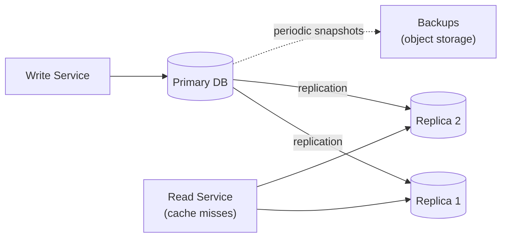

- **Replication:** if the primary fails, promote a replica (automatic failover in managed databases).
- **Backups:** periodic snapshots for disaster recovery.

### 11.2 Split reads and writes

Reads and writes have completely different shapes, so we separate them into two services that scale independently.

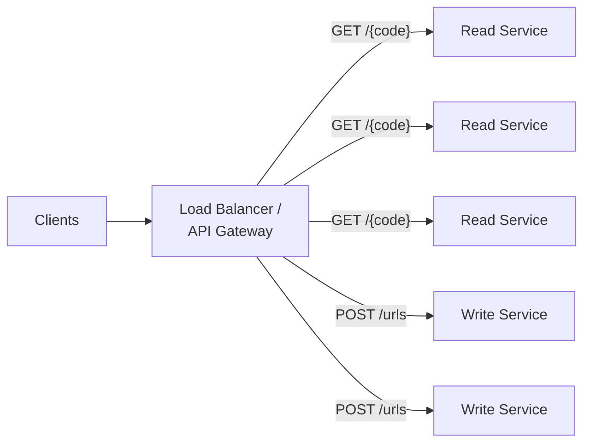

| | Read Service | Write Service |
|---|---|---|
| Handles | Redirects | Creating short URLs |
| Traffic | ~600k/sec peak | ~1–2/sec |
| Instances | Many | A few (for availability) |
| Talks to | CDN, Redis cache, DB replicas | Counter, DB primary |

Both are **stateless**, so we scale them **horizontally**: add instances behind the load balancer.

### 11.3 The counter problem

Once there are several Write Service instances, they all need to agree on the **next counter value**. Otherwise two servers could hand out the same code.

**Solution: one central Redis counter.** Every Write Service calls `INCR` on it.

But that's a network call per new URL. Can we do better?

### 11.4 Counter batching

Instead of asking for one number at a time, each Write Service reserves a **batch** of numbers.

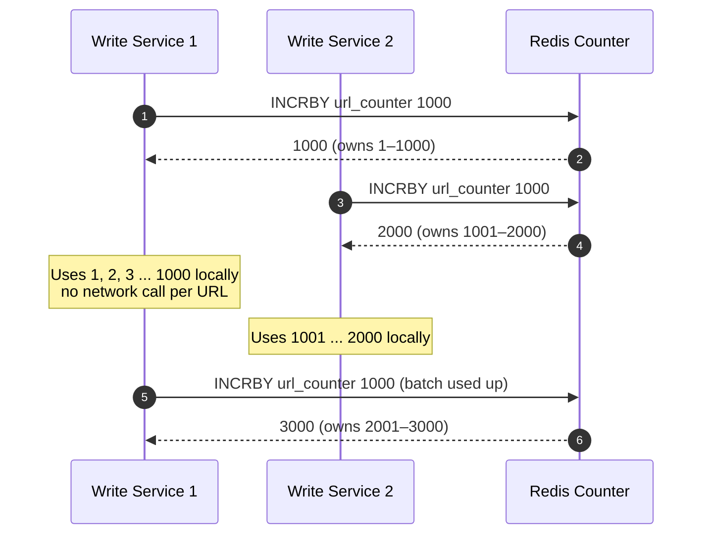

1. Each Write Service asks Redis for 1,000 numbers at once (`INCRBY 1000`).
2. Redis atomically adds 1,000 and returns the end of the range.
3. The service hands out those numbers locally, with no network call per URL.
4. When the batch runs out, it asks for another.

**Benefits:** far fewer calls to Redis, and uniqueness is still guaranteed because ranges never overlap.

**What if a server crashes mid-batch?** Its unused numbers are simply skipped. That's fine: we need **uniqueness, not continuity**. Gaps in the sequence don't matter.

### 11.5 Counter availability

- Run Redis with **Sentinel** or **Redis Cluster** for automatic failover.
- One Redis instance handles **100k+ ops/sec**, far more than we need, especially with batching.
- **If failover loses the last few increments:** a new primary might hand out a number that was already used. The database's `UNIQUE` constraint on `short_code` catches it. On a duplicate-key error, the Write Service **grabs a fresh batch and retries**.

Alternatives for the counter, if asked: a Postgres `SEQUENCE` or a small DB-backed range allocator (batching keeps its load tiny), or Snowflake IDs (no shared counter, but longer codes).

### 11.6 Multi-region

Give each region its **own counter range**, so regions never need to coordinate.

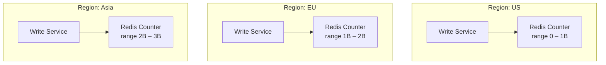

- **Writes** go to the local region's counter.
- **Reads** are served globally from CDNs and regional caches.

---

## 12. Final Architecture

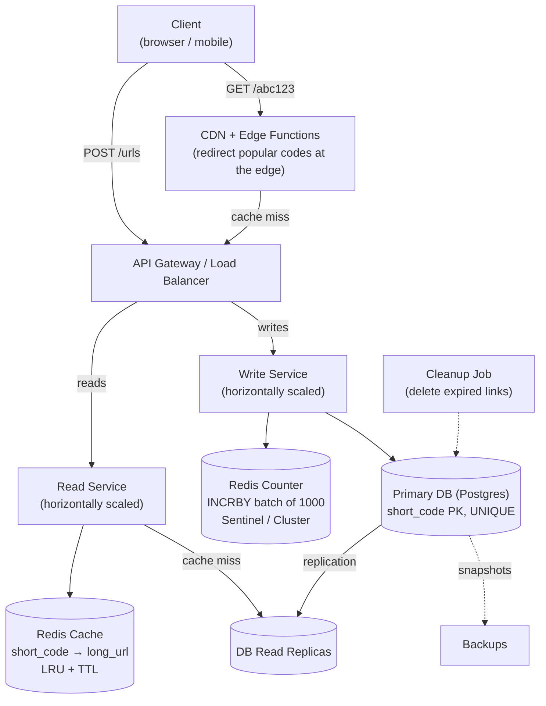

### Request flows in the final design

**Create:**
`Client → Load Balancer → Write Service → (batched counter → Base62 code) → Primary DB → 201 short URL`

**Redirect:**
`Client → CDN edge → (miss) Load Balancer → Read Service → Redis → (miss) DB replica → fill Redis → 302 redirect`

### How each requirement is satisfied

| Requirement | How |
|---|---|
| Short URL creation | Write Service + counter + Base62 |
| Custom alias | Validated against DB, separate namespace from generated codes |
| Expiration | `expires_at` column, `410 Gone`, cache TTL ≤ expiry, cleanup job |
| Redirect | Read Service, `302` |
| Uniqueness | Non-overlapping counter batches + `UNIQUE` primary key |
| < 100 ms latency | CDN edge + Redis cache + primary key index |
| 99.99% availability | Stateless services, replicas, Redis failover, multi-region |
| 1B URLs / 100M DAU | ~500 GB single DB, cache absorbs reads, services scale horizontally |

---

## 13. Failure Scenarios

| What fails | Impact | Mitigation |
|---|---|---|
| **A Read/Write Service instance** | Requests to that instance fail | Load balancer health checks route around it |
| **Redis cache** | All reads hit the database | DB replicas absorb load; circuit breaker to protect DB; small in-process cache for the hottest links |
| **Redis counter** | Can't create new URLs (redirects still work) | Sentinel/Cluster failover; servers keep using their current batch meanwhile |
| **Counter loses recent increments** | Possible duplicate code | `UNIQUE` constraint rejects it; fetch a new batch and retry |
| **Primary DB** | Writes fail briefly | Promote a replica (automatic failover) |
| **A viral link's cache entry expires** | Burst of identical misses hits DB | Request coalescing (single flight) |
| **A whole region** | Users in that region affected | Other regions keep serving via DNS/CDN routing |

> Notice that **redirects keep working even if writes are down.** Since the read path is what users touch 1,000× more often, that's exactly the right priority.

---

## 14. Security Considerations

- **Predictable codes:** counter-based codes can be enumerated. Obfuscate the number before encoding (XOR with a secret, or a format-preserving cipher), and add rate limiting.
- **Private URLs:** short links shouldn't be used for secret content. If needed, use longer, random codes to make guessing impractical.
- **Abuse and spam:** rate limit `POST /urls` per user/IP; optionally scan destinations against malicious URL lists.
- **Open redirect misuse:** validate URL schemes (`http`/`https` only), and block known phishing domains.
- **Business info leakage:** sequential codes reveal how many links you've created. Obfuscation hides this from competitors.

---

## 15. What Interviewers Expect at Each Level

| Level | Expectations |
|---|---|
| **Mid-level** | A working design for create and redirect. At least one uniqueness approach (hash or counter). Understands why `302`. Knows to index the short code. Recognizes, with some prompting, that a cache helps a read-heavy system. |
| **Senior** | Drives the discussion. Explains the hashing (collisions) vs counter (coordination) trade-off unprompted. Covers caching in detail, including invalidation for expired links. Justifies the database choice. Splits read and write services. Scales the counter with Redis and batching. |
| **Staff+** | Frames the design around the read-heavy workload from the start. Brings up multi-region counter ranges, Redis failover behavior, and predictable-code security without prompting. Thinks about alias collisions, cleanup, operations, and how the system would evolve (e.g. adding analytics). |

---

## 16. Interview Walkthrough Script

A suggested order and talking points for a ~45 minute interview:

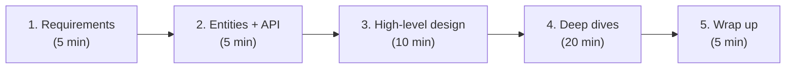

1. **Requirements:** "Shorten, optional alias and expiry, redirect. Analytics out of scope. Availability over consistency. Key insight: ~1000:1 reads to writes."
2. **Estimation:** "~600k reads/sec at peak, ~1 write/sec, ~500 GB total. One database is enough; reads are the challenge."
3. **API:** "`POST /urls` and `GET /{code}` returning `302`."
4. **High-level design:** client → server → database, walk through both flows.
5. **Deep dive, uniqueness:** compare prefix, hash, counter; pick counter + Base62.
6. **Deep dive, latency:** primary key index → Redis cache-aside → CDN edge.
7. **Deep dive, scale:** split read/write services, central counter with batching, failover, multi-region ranges.
8. **Wrap up:** failure scenarios and what you'd add next (analytics, abuse detection).

---

## 17. Cheat Sheet

| Question | Answer |
|---|---|
| Read/write ratio? | **~1000:1** → optimize reads |
| Peak reads? | **~600k/sec** |
| Writes? | **~1–2/sec** |
| Storage? | **~500 GB** → single DB, no sharding |
| Database? | Postgres (anything works) |
| Primary key? | `short_code` (index + uniqueness) |
| Code generation? | **Counter + Base62** (or hash + Base62 + retry) |
| Why Base62? | URL-safe: no `+` or `/` |
| Code length at 1B URLs? | **6 characters** |
| 301 or 302? | **302**: keep control, enable expiry and analytics |
| Expired link? | **410 Gone** |
| Fast redirects? | PK index → **Redis cache-aside (LRU + TTL)** → **CDN edge** |
| Scaling services? | **Split read/write**, stateless, horizontal |
| Shared counter? | **Redis `INCRBY` batches of 1,000** |
| Counter failover? | Sentinel/Cluster; `UNIQUE` constraint as safety net |
| Multi-region? | **Separate counter ranges** per region |

> **Golden rule:** start from the 1000:1 read ratio. The `302` redirect, the primary-key index, the cache, the CDN, and the read/write split all follow from it.
